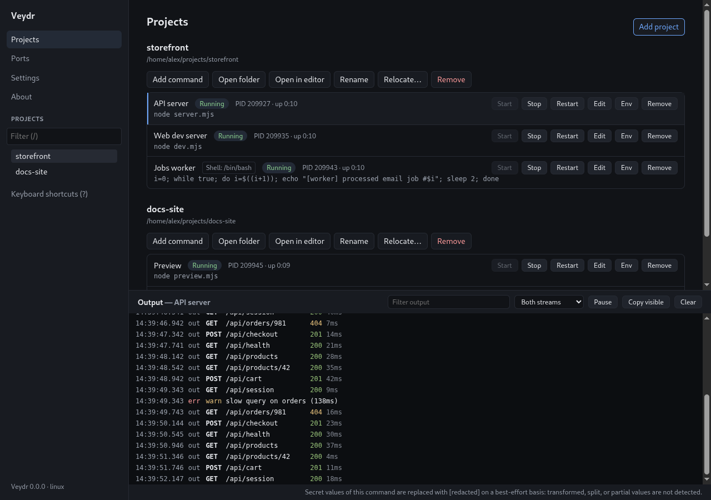
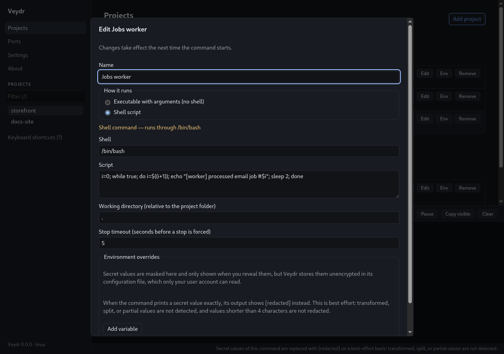
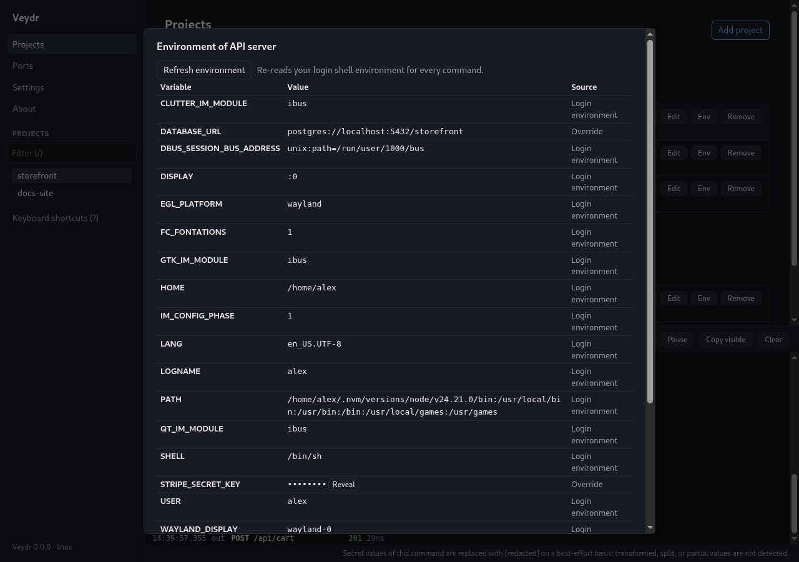
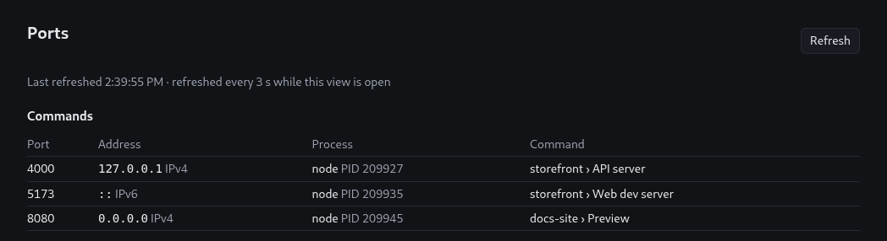

<p align="center">
  <picture>
    <source media="(prefers-color-scheme: dark)" srcset="assets/brand/veydr-logo.svg">
    
  </picture>
</p>

<p align="center">
  <strong>One window for all your local dev commands.</strong><br>
  Start, stop, and watch the servers, workers, and scripts of every project you work on.
</p>

<p align="center">
  Linux x64 &nbsp;·&nbsp; Local-only &nbsp;·&nbsp; <a href="LICENSE">MIT license</a>
</p>

<p align="center">
  
</p>

---

Veydr is a desktop app for developers who run several long-lived commands across several local projects: an API server, a frontend dev server, a background worker, a docs preview. You usually end up with a pile of terminal tabs. Veydr replaces them with one window. You register each project once, configure its commands, and from then on you start and stop them with a click and read their output in one place. Veydr also tells you which ports they listen on.

Veydr does nothing unless you ask it to. A command starts only when you press **Start**, a command that exits is never restarted on its own, and when you quit, Veydr stops what it started. It runs entirely on your machine: no accounts, no cloud sync, no telemetry, and no network access of its own.

> [!NOTE]
> **Linux only; Windows not yet supported.** Veydr is an early release (version 0.0.0). It runs on Linux x64. Windows and macOS are not supported yet, and no prebuilt releases have been published. You build the packages from source (see [Installation](#installation)).

## Contents

- [Features](#features)
- [Platform support](#platform-support)
- [Installation](#installation)
- [Quick start](#quick-start)
- [Using Veydr](#using-veydr)
- [Known limitations](#known-limitations)
- [Documentation](#documentation)
- [Development](#development)
- [Contributing and reporting issues](#contributing-and-reporting-issues)
- [License](#license)

## Features

### Projects and commands
- **Projects are local folders.** Add one with the system folder picker. Veydr never writes into it. **Open folder** opens it in your file manager, and **Open in editor** opens it in the editor you configure in **Settings**.
- **Two ways to run a command.** *Executable with arguments* runs a program directly, with each argument passed exactly as typed (no shell involved). *Shell script* runs a script through a shell you choose (default `/bin/sh`) for pipes, `&&`, and variable expansion. Shell commands are labelled with their shell.
- **Per-command settings:** a working directory inside the project folder, environment variable overrides, and a stop timeout.
- **Your login environment.** Commands get the environment your login shell sets up (for example `PATH` entries from `~/.profile`), even when Veydr was opened from the desktop launcher. The **Env** view shows exactly what a command will receive and where each value comes from.
- **Secret values.** Mark an override as secret and it is masked in the interface until you reveal it. If a command prints it, the output shows `[redacted]` instead (best effort).
- **Missing folders are detected.** A project whose folder was moved or deleted is marked **Folder missing**, and **Relocate…** points it at the new location.

### Process supervision
- **Start, Stop, Restart** for every command, with live states: Idle, Starting, Running (PID and uptime), Stopping, Exited (exit code or signal), and Failed (with the reason, such as `Executable not found: node (searched PATH)`).
- **Stops the whole process tree.** Each command runs in its own process group. Stopping sends `SIGTERM` to the command and its child processes, and sends `SIGKILL` after the stop timeout (5 seconds by default). Anything still alive afterwards is listed, never hidden.
- **Clean quit.** Closing Veydr stops every running command first. If a process survives, Veydr asks whether to retry or leave it running.
- **Crash recovery.** If Veydr itself ends abnormally, the next launch lists the processes your commands left behind. You decide whether to **Terminate** them or **Leave running**. Veydr never signals anything on its own.

### Output
- **Live output** of standard output and standard error, with capture time and the stream (`out`/`err`) on every line.
- **Colors stay, escape tricks don't.** ANSI colors and styles are rendered. Every other terminal control sequence is removed, so output can't change the window title or write to the clipboard.
- **Filter** by text, show one **stream** or both, **Pause** and **Follow**, **Copy visible** as plain text, and **Clear**.
- **Bounded memory.** Output is kept in memory only (never written to disk): up to 10,000 lines or 8 MiB per run, for the current and the previous run of each command.

### Ports
- **See who is listening.** The **Ports** view lists listening TCP ports (IPv4 and IPv6), shows which ones belong to your commands, and identifies the owning process and PID.
- **Read-only.** The view never stops, signals, or connects to anything. Ports owned by other users or the system are marked **Restricted** instead of being guessed.

### Keyboard
Single-key shortcuts for common actions. Press <kbd>?</kbd> in the app to see the list (see [Keyboard shortcuts](#keyboard-shortcuts)).

### Local-first and hardened
- Configuration is a single JSON file in `~/.config/Veydr/`, readable only by your user (mode `0600`). It is saved atomically and keeps a backup.
- The interface runs in Chromium's sandbox with context isolation. Veydr refuses to start without the sandbox.
- No telemetry, update checks, or remote content. See [security-baseline.md](docs/security-baseline.md) and [network-isolation.md](docs/network-isolation.md).

<table>
  <tr>
    <td width="50%"></td>
    <td width="50%"></td>
  </tr>
  <tr>
    <td align="center"><sub>Command editor: direct or shell mode, working directory, stop timeout, environment overrides</sub></td>
    <td align="center"><sub>Env view: the exact environment a command gets, with secrets masked</sub></td>
  </tr>
</table>

<p align="center">
  <br>
  <sub>Ports view: each listening port matched to the command that owns it</sub>
</p>

## Platform support

| Platform | Status |
|---|---|
| **Linux x64** | Supported (see the distribution table below) |
| Linux on other architectures | Not supported; packages are built for x64 only |
| Windows | **Not yet supported.** Planned as a follow-up; no Windows build exists yet |
| macOS | Not supported |

**Linux distributions.** These results come from `scripts/smoke-linux.sh`, which ran the packaged app's built-in smoke test inside Docker containers on 2026-10-25. They are not results from full desktop installations. Details are in [install-linux.md](docs/install-linux.md#supported-distributions).

| Distribution | `.deb` | AppImage |
|---|---|---|
| Debian 12, Debian 13 | Passed | Passed |
| Ubuntu 22.04 | Passed | Passed |
| Ubuntu 24.04 | Passed in a container; **not yet validated on a real Ubuntu 24.04 host** | Does **not** start on a stock Ubuntu 24.04 desktop (see below) |
| Fedora 44 | n/a | Passed |

> [!IMPORTANT]
> **Ubuntu 24.04 validation is outstanding.** Ubuntu 24.04 restricts unprivileged user namespaces through AppArmor, and Chromium's sandbox needs them. The `.deb` installs an AppArmor profile for Veydr to allow this, but the profile has not yet been seen working on a real Ubuntu 24.04 host with the restriction enabled. Containers don't reproduce that restriction. The AppImage cannot use the profile and does not start there.

### Available now vs. not available

| Available now | Not available yet |
|---|---|
| Projects, commands (direct and shell), environment overrides, secret masking | Windows support (planned) |
| Start, stop, restart; process-tree stop; clean quit; crash recovery | Keychain-backed secret storage (secrets are stored unencrypted for now) |
| Live output with colors, filter, follow/pause, copy, clear | Viewing a previous run's output (it is kept, but not shown yet) |
| Listening-port inspection | Published prebuilt releases |
| `.deb` and AppImage packages, built from source | macOS support, auto-update, code signing |

Veydr is deliberately not a terminal emulator. Commands get no interactive input (stdin), there is no auto-restart or watch mode, and output is never written to log files. Docker, Git, and tray integration are also out of scope for this release.

## Installation

### Download a release

No releases have been published yet. Until they are, build the packages yourself as described below. It takes one command.

### Build the Linux packages

You need **Node.js 24** and **npm 11.19.0 or newer** (see [Development](#development) for details).

```bash
git clone https://github.com/alexnakagama/veydr.git
cd veydr
npm ci
npm run dist:linux
```

This writes two packages to `dist/`. With the current version they are named:

- `dist/Veydr-0.0.0-amd64.deb`
- `dist/Veydr-0.0.0-x86_64.AppImage`

The first run downloads electron-builder's Linux packaging tools into `~/.cache/electron-builder`.

### Install the `.deb` (Debian, Ubuntu; recommended)

```bash
sudo apt install ./dist/Veydr-0.0.0-amd64.deb
```

`apt` pulls in the libraries Veydr needs. Veydr is installed to `/opt/Veydr`, linked as `/usr/bin/veydr`, and gets a desktop entry. Where AppArmor supports it, the package also installs a profile (`/etc/apparmor.d/veydr`) that lets Chromium's sandbox work under Ubuntu 24.04's user-namespace restriction (see the note above).

Start Veydr from your application menu, or run:

```bash
veydr
```

To uninstall it (your configuration in `~/.config/Veydr` is kept):

```bash
sudo apt remove veydr
```

### Run the AppImage (other distributions)

```bash
chmod +x dist/Veydr-0.0.0-x86_64.AppImage
./dist/Veydr-0.0.0-x86_64.AppImage
```

The AppImage needs two things from the system:

- **FUSE 2 (`libfuse2`)** to mount itself. Most recent distributions don't install it by default: install `libfuse2` (Ubuntu 22.04), `libfuse2t64` (Ubuntu 24.04), or `fuse-libs` (Fedora). Alternatively, run it with `APPIMAGE_EXTRACT_AND_RUN=1`. This works without FUSE but extracts the image to `/tmp` on every start.
- **Unprivileged user namespaces.** Without them, the AppImage launcher adds `--no-sandbox`, and Veydr refuses to start without its sandbox. This is the case on Ubuntu 24.04 by default and on some hardened systems. Use the `.deb` there.

### Check an installation

```bash
veydr --smoke-test
```

The smoke test checks that Veydr can run on this system (sandbox, configuration directory, `/proc` access, interface), prints a line starting with `VEYDR_SMOKE_TEST` with a JSON report, and exits with status 0 if every check passed. For the AppImage, run `./dist/Veydr-0.0.0-x86_64.AppImage --smoke-test`. Close a running Veydr first: the smoke test exits with status 1 when another instance is running.

More details, including requirements and troubleshooting, are in [docs/install-linux.md](docs/install-linux.md).

### Run from source (development)

```bash
npm ci
npm run dev
```

This starts Veydr with hot reload for the interface. See [Development](#development).

## Quick start

1. **Add a project.** On the **Projects** page, click **Add project**, choose a folder (for example your web app's repository), and confirm the suggested name.
2. **Add a command.** Under the project, click **Add command**. Give it a name such as `Dev server`, keep **Executable with arguments**, enter the executable `npm`, and use **Add argument** twice for `run` and `dev`. Leave the working directory at `.` (the project folder) and save.
3. **Start it.** Click **Start** on the command (or select it and press <kbd>s</kbd>). Its state changes to **Running** with its PID and uptime.
4. **Watch the output.** Click the command to show its output in the panel at the bottom. Type in **Filter output** to find a line, or **Pause** to stop scrolling while you read.
5. **Find its port.** Open **Ports** to see which port your dev server listens on, attributed to `your-project › Dev server`.
6. **Stop it.** Click **Stop** (or press <kbd>x</kbd>). When you quit Veydr, it stops any commands still running.

Add more commands and projects the same way. Every command runs, stops, and shows output independently.

## Using Veydr

### Example commands

The screenshots above show two example projects. This is how their commands are configured:

| Command | Mode | Configured as | Working directory |
|---|---|---|---|
| API server | Executable with arguments | `node` · `server.mjs` | `api` |
| Web dev server | Executable with arguments | `node` · `dev.mjs` | `web` |
| Jobs worker | Shell script (`/bin/bash`) | `i=0; while true; do i=$((i+1)); echo "[worker] processed email job #$i"; sleep 2; done` | `.` |
| Preview | Executable with arguments | `node` · `preview.mjs` | `.` |

Use **Executable with arguments** by default: each argument reaches the program exactly as typed, so spaces, quotes, `$`, or `*` need no escaping. Switch to **Shell script** when you need shell features such as pipes, `&&`, or globbing.

The API server also has two environment overrides: `DATABASE_URL`, and `STRIPE_SECRET_KEY` marked as **secret**. The secret is masked in the editor and the **Env** view, and replaced by `[redacted]` if the server ever prints it.

### Command actions

| Action | What it does |
|---|---|
| **Start** | Starts the command. A command that is already running is not started twice. |
| **Stop** | Sends `SIGTERM` to the command's processes, then `SIGKILL` after the stop timeout. |
| **Restart** | Stops the command completely, then starts it again. |
| **Edit** | Changes the command. Changes take effect the next time it starts. |
| **Env** | Shows the environment the next start would use. **Refresh environment** re-reads your login shell. |
| **Remove** | Removes the command from Veydr (stop it first). |

### Keyboard shortcuts

Shortcuts work outside text fields. Select a command by clicking it or moving to it with <kbd>Tab</kbd>.

| Key | Action |
|---|---|
| <kbd>s</kbd> | Start the selected command |
| <kbd>x</kbd> | Stop the selected command |
| <kbd>r</kbd> | Restart the selected command |
| <kbd>/</kbd> | Focus the project filter |
| <kbd>j</kbd> / <kbd>k</kbd> | Go to the next / previous project |
| <kbd>?</kbd> | Show keyboard shortcuts |

### Opening projects in your editor

In **Settings › Editor**, set the editor's executable (for example `code`) and its arguments. One argument must contain `{path}`, which is replaced by the project folder. **Open in editor** then starts the editor directly, without a shell, with your login environment.

### Where your data lives

Everything is stored in `~/.config/Veydr/` (or `$XDG_CONFIG_HOME/Veydr/`): `config.json` with your projects, commands, and settings, plus a backup. Veydr also keeps a record of running commands there, which it uses for crash recovery. See [configuration.md](docs/configuration.md).

## Known limitations

- **Secrets are stored unencrypted.** Values marked secret are masked in the interface, but they are saved in plain text in `config.json`, protected only by its file permissions (`0600`). Redaction in output is best effort: values that are transformed, split, or shorter than 4 characters are not detected. Values from your own login environment are shown unmasked in the **Env** view. See [commands.md](docs/commands.md#secrets) and [logs.md](docs/logs.md#secret-values-in-output).
- **Crash cleanup has limits.** If Veydr ends abnormally, the processes of its running commands keep running until Veydr is started again and you terminate them (a process that writes output after that usually ends itself, because its output has no reader any more). A descendant that detached into its own session before Veydr observed it, or one started in the last moments before the crash, may not be found. Processes running as another user (for example through `sudo`) cannot be stopped. See [processes.md](docs/processes.md#limitations).
- **Ubuntu 24.04** is not yet validated on a real host, and the AppImage does not start there by default (see [Platform support](#platform-support)).
- **No interactive input.** Commands' standard input is not connected, and terminal features beyond colors are not emulated.
- **Ports** covers listening TCP sockets in Veydr's own network namespace. UDP, outgoing connections, and container-internal ports are not shown. See [ports.md](docs/ports.md).

## Documentation

| Topic | Document |
|---|---|
| Installing on Linux, requirements, distribution results | [docs/install-linux.md](docs/install-linux.md) |
| Projects, command modes, environment, secrets, editor | [docs/commands.md](docs/commands.md) |
| Starting, stopping, quitting, crash recovery | [docs/processes.md](docs/processes.md) |
| Output capture, limits, controls, redaction | [docs/logs.md](docs/logs.md) |
| Port inspection | [docs/ports.md](docs/ports.md) |
| Configuration file, location, backups, permissions | [docs/configuration.md](docs/configuration.md) |
| Security baseline | [docs/security-baseline.md](docs/security-baseline.md) |
| Network isolation | [docs/network-isolation.md](docs/network-isolation.md) |
| Dependencies and version policy | [docs/dependencies.md](docs/dependencies.md) |
| Checks deferred to packaging | [docs/deferred-checks.md](docs/deferred-checks.md) |
| CI pipeline, workflow security rules, releases | [docs/ci.md](docs/ci.md) |
| Architecture and design decisions | [openspec/changes/archive/2026-10-25-establish-foundation/design.md](openspec/changes/archive/2026-10-25-establish-foundation/design.md) |

## Development

Veydr is an Electron application written in TypeScript with a React interface. It has three isolated layers: the main process (`src/main`) holds all privileged logic, a narrow preload API (`src/preload`) connects it to a sandboxed renderer (`src/renderer`), and `src/shared` holds code used by more than one layer. The platform-specific parts live under `src/main/platform` (`linux/` today, plus a `windows/` stub). The design is documented in [openspec/changes/archive/2026-10-25-establish-foundation/design.md](openspec/changes/archive/2026-10-25-establish-foundation/design.md).

### Prerequisites

- Linux x64
- **Node.js 24** (`.nvmrc`; with nvm, run `nvm use`)
- **npm 11.19.0 or newer**. `.npmrc` sets `engine-strict=true`, so older versions are refused. See [dependencies.md](docs/dependencies.md) for why.
- `bash` and `env`, which Veydr uses to start commands (installed on every common distribution)

### Setup and common tasks

```bash
npm ci                 # install the exact locked dependencies
npm run dev            # run Veydr with hot reload
npm run build          # build the production bundle into out/
```

### Checks

```bash
npm run typecheck      # TypeScript, every layer
npm run lint           # ESLint, zero warnings allowed
npm test               # unit tests (Vitest)
npm run verify         # typecheck + lint + unit + integration + spec coverage
npm run test:e2e       # end-to-end tests of the built app (Playwright + Electron)
npm run test:perf      # high-volume output performance scenarios
```

### Packaging

```bash
npm run dist:linux       # build the .deb and AppImage into dist/
npm run test:packaging   # build the packages, then test them (contents, fuses, glibc, smoke test)
```

`scripts/smoke-linux.sh` runs the packaged smoke test across distributions in Docker containers. It is the source of the [distribution table](#platform-support).

## Contributing and reporting issues

Bug reports and suggestions are welcome on [GitHub Issues](https://github.com/alexnakagama/veydr/issues). For a bug, please include your distribution and version, how you installed Veydr (`.deb`, AppImage, or source), and if relevant the output of `veydr --smoke-test`.

There is no formal contribution guide yet. If you plan a larger change, please open an issue first. Before sending a pull request, run `npm run verify` and, for changes to the interface or process handling, `npm run test:e2e`.

## License

Veydr is released under the [MIT License](LICENSE). Copyright © 2026 alexnakagama.
